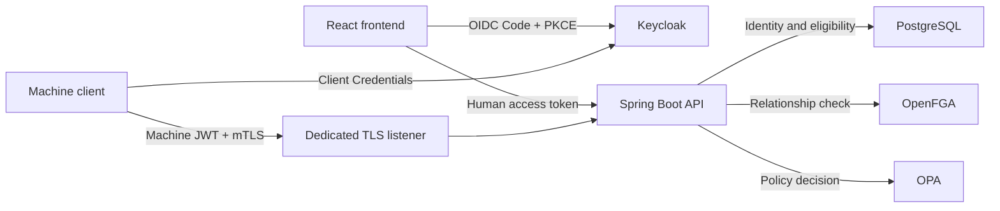

# Enterprise IAM & Zero Trust Reference Implementation

A multi-tenant project/document application demonstrating identity verification,
relationship-based access control and policy enforcement for human and machine
callers. The development project combines a React console, Keycloak, Spring Boot,
PostgreSQL, OpenFGA and OPA in a Docker Compose local lab; this candidate supplies
a narrower offline review and testing scope.

**Publication scope: offline implementation review and security regression.** The
sanitized reference is [published on GitHub](https://github.com/rvarkali/enterprise-identity-security-reference)
with fresh publication history; the original development history is not included.
It includes human/machine IAM, resource authorization, selected tests and sanitized
configuration examples.
It does not include a runnable Compose deployment, the gateway, administrative
processes, lifecycle implementation or live acceptance tooling.

This is an engineering reference and portfolio project, **not a production-ready
IAM platform**. Source implementation, offline regression, isolated rehearsals and
historical live observations are distinguished below. Successful tests do not
establish publication readiness or authorize deployment.

## Publication status

**Published as an offline reference implementation.** This is a derivative of one
development implementation, not a second IAM implementation. Publication covers
the offline implementation and regression scope, not a runnable deployment.

The owner confirms local-Mac-only development, no external deployment, no future
deployment plans, and no reuse outside this project of the four exposed credential
categories. Historical public exposure is acknowledged. The owner accepts its
residual risk and confirms that the original repository is retained privately.
These scope, non-reuse and visibility statements are **OPERATOR_REPORTED**.

The preceding authorized stop-only operation verified zero running IAM containers
and zero active IAM Docker port bindings. All 56 IAM containers, 27 volumes and
10 networks were preserved. Persistent credential/session state may remain.
CRED-001 through CRED-004 remain **OPEN_RISK_ACCEPTED**, not technically remediated:
no rotation, invalidation or verified revocation is claimed. Risk acceptance
is the documented disposition for this published offline portfolio; it does not
authorize restarting the runtime or establish credential remediation.

The [publication manifest](docs/security/publication-manifest.json)
excludes its own hash and Git metadata, and records exact payload paths, hashes and
validation evidence. It distinguishes the published baseline from the current
documentation revision; local edits are not automatically committed or published.
The original development Git history remains excluded.
See the [current validation record](docs/security/portfolio-validation-summary.md)
and [credential disposition](docs/security/public-credential-exposure-response.md).

| Review label | Meaning in this candidate |
|---|---|
| IMPLEMENTED | Included source/configuration exists; deployment is not implied |
| HISTORICALLY_TESTED | A prior, explicitly attributed test or isolated check is retained |
| CURRENTLY_VERIFIED | A bounded check was performed during final publication preparation; the validation record identifies its exact scope and result |
| EXCLUDED | Compose, gateway, administrative/lifecycle implementation, live acceptance and protected runtime artifacts are outside this snapshot |
| NOT_VERIFIED | Credential invalidation/revocation and deployment equivalence remain unverified; scope/non-reuse and original Private visibility are operator-reported |

## Architecture

| Component | Responsibility |
|---|---|
| React / TypeScript frontend | IdentityGuard console, OIDC login/callback handling and authenticated resource requests |
| Keycloak | OIDC identity provider; human Authorization Code + PKCE and machine OAuth2 Client Credentials |
| Spring Boot resource API | JWT validation, principal resolution, listener separation and authorization orchestration |
| PostgreSQL | Authoritative identities, active tenant membership, resource ownership and classification |
| OpenFGA | Relationship-based permission decisions |
| OPA | Additional policy decisions using backend-derived resource context |
| Machine TLS connector | Client certificate verification and certificate/JWT identity association |
| Docker Compose | Development-repository architecture only; deployment definitions are excluded from this candidate |



The API orchestrates the authorization checks; the database does not call the
policy services. Human HTTP and machine HTTPS listeners share one API process,
so listener separation is not process isolation. The development repository uses
an OpenFGA gateway/core topology whose implementation is outside this candidate.
The diagram above describes logical integrations, not an executable deployment.
The authentication and authorization sections below describe the included source.

## Human authentication

1. The frontend starts Keycloak **Authorization Code + PKCE S256** using a public
   client and a registered callback. No browser client secret is required.
2. The callback completes the code exchange. The SPA uses an access token for API
   requests and keeps its OIDC state/session in JavaScript-accessible sessionStorage.
3. The API validates the JWT signature against configured JWKS, issuer, API audience
   and timestamps. Current source also explicitly requires an `exp` claim; checking
   expiry only when present is insufficient.
4. The validated issuer/subject resolves to an internal principal before tenant
   and resource authorization. Email and caller-supplied tenant claims are not
   authoritative identity/ownership inputs.

**Deployment distinction:** retained evidence reports passing tests and a packaged
image for the mandatory human `exp` correction, but no deployment of that image
to the protected development API. Current deployment equivalence is NOT_VERIFIED.
Source-only hardening is not evidence of current live behavior.

References: [frontend OIDC configuration](apps/web/src/auth.ts),
[human JWT security chain](apps/api/src/main/java/dev/portfolio/iam/SecurityConfig.java),
human authentication design (development-repository reference; omitted from this candidate).

## Machine authentication

A separately provisioned confidential client obtains a token through **OAuth2
Client Credentials**. The machine security chain validates the signature, issuer,
dedicated audience, authorized client, service-account subject, time claims and
required role. Requests also need a trusted X.509 client certificate on the
**dedicated TLS listener**. Its exact URI SAN must match the configured identity
associated with the JWT.

The listener guard relies on actual connector evidence, not caller-supplied
forwarded headers. Machine routes are denied through the human HTTP listener;
human routes are denied through the machine listener. Certificate/JWT association
is application-level identity binding, **not OAuth `cnf` thumbprint-bound tokens**.

The machine endpoint `GET /api/machine/policy/health` demonstrates protected
liveness only; it does not evaluate OpenFGA or OPA policy. See the
machine authentication flow (development-repository reference; omitted from this candidate),
[machine implementation](apps/api/src/main/java/dev/portfolio/iam/machine/) and
development certificate lifecycle (development-repository reference; omitted from this candidate).

## Authorization and tenant isolation

Human resource reads require all applicable gates, in order:

1. **PostgreSQL eligibility:** resolve the principal and require active identity,
   tenant and membership state; derive resource ownership/classification from data.
2. **OpenFGA relationship check:** require the appropriate resource permission.
3. **OPA policy decision:** evaluate additional backend-derived context after the
   earlier gates allow access.

Denial, malformed responses, invalid dependency configuration and dependency
failures never grant access. Cross-tenant resource access is concealed where
specified by the API contract; other denials and unavailable dependencies remain
explicit failures. OPA ALLOW cannot bypass PostgreSQL or OpenFGA.

Trusted live MFA assurance is not integrated: the backend supplies no trusted
assurance value and the default allowlist is empty. Confidential-document reads
therefore remain denied under that configuration. Synthetic policy demonstrations
must not be presented as live MFA acceptance.

Implementation: [resource enforcement](apps/api/src/main/java/dev/portfolio/iam/resources/ResourceReadService.java),
[eligibility/relationship gate](apps/api/src/main/java/dev/portfolio/iam/authorization/AuthorizationService.java),
[OpenFGA model](authorization/openfga/model.fga), [OPA policy](authorization/opa/policies/access.rego).

## Capability status

The retained capability table describes historical evidence scope, not a single
maturity ladder or a fresh deployment check. **IMPLEMENTED**
means source exists; **VERIFIED_OFFLINE** means selected tests passed without live
IAM dependencies; **VERIFIED_ISOLATED** means a bounded disposable-environment
check passed. **HISTORICALLY_VERIFIED_LIVE** refers to recorded earlier observations,
not current uptime or a fresh regression. **PARTIAL** and **PLANNED** retain open scope.

| Capability | Status | Evidence and boundary |
|---|---|---|
| React console and human OIDC/PKCE integration | IMPLEMENTED; PARTIAL | Source flow exists; operator-reported logins do not establish complete independent browser/security acceptance |
| Human JWT signature, issuer, audience and required-exp validation | VERIFIED_OFFLINE | Actual decoder/chain exercised with synthetic signing keys; required-exp correction remains undeployed |
| Machine JWT, certificate binding and listener/TLS boundaries | VERIFIED_OFFLINE; HISTORICALLY_VERIFIED_LIVE | Selected regression tests plus historical B5 positive/negative machine observations; not a fresh deployment check |
| PostgreSQL eligibility, tenant/resource gates and OpenFGA/OPA client failures | VERIFIED_OFFLINE | Mocked DB/HTTP dependencies; not a full live resource traversal |
| Nginx callback access-log protection | VERIFIED_ISOLATED | Synthetic callbacks served the SPA without access-log entries; routing checks passed; not deployed |
| Hardened OIDC client import | VERIFIED_ISOLATED | Fresh disposable Keycloak import passed; browser login/logout not revalidated |
| Reserved-character database credentials | VERIFIED_ISOLATED | Disposable PostgreSQL/OpenFGA migration and server connectivity passed; live credentials unchanged |
| API handoff and rollback | VERIFIED_ISOLATED | Synthetic configuration/startup and injected-failure recovery; no live authorization acceptance implied |
| Development certificate generation and manual rotation procedure | IMPLEMENTED; PARTIAL | Generator and validation coverage; complete dedicated rotation acceptance summary remains open |
| Joiner/mover/leaver lifecycle | PARTIAL in development repository | Administrative/lifecycle implementation is omitted here; included UI summaries and model fixtures are illustrative |
| Trusted live MFA assurance | PARTIAL | Fail-closed policy path and synthetic demonstrations; trusted identity-provider claim mapping incomplete |
| Full SCIM provisioning; Microsoft Entra ID integration | PLANNED | Full SCIM is not implemented; Entra integration is deferred |

Historical machine observations include valid token/certificate acceptance,
missing-certificate TLS rejection, invalid-token rejection and trusted wrong-URI
certificate denial. Their attribution and limits are recorded in the
security validation report (development-repository reference; omitted from this candidate).
Protected raw evidence and operational PKI are deliberately not publication assets.
Some linked documents describe earlier milestones; their historical counts and
verification gaps should be read alongside the latest bounded results below.

## Reproducible security regression

From the repository root:

```sh
python3 infrastructure/testing/security_regression.py
```

Requires Python 3.9+, Maven with cached dependencies/plugins, **JDK 21** including
keytool, and permission to bind temporary test sockets. Set `JAVA21_HOME` when
needed; another Java major is rejected. The runner uses offline Maven resolution,
selected existing tests and synthetic fixtures. It does not start Docker Compose,
retrieve credentials or use existing private PKI.

Original consolidated execution: **2026-10-20, P2.2E6**, exit code 0.
Historical candidate execution: **P2.3H**, exit code 0, with the same counts below.
The latest final-preparation execution passed 187 Java and 72 Python tests.
Its status and unchanged test-input identity
is in the [validation summary](docs/security/portfolio-validation-summary.md).

| Suite | Result |
|---|---|
| Selected Java security tests | **187 passed**, zero failures/errors/skips |
| Offline Python security tests | **72 passed**, zero failures/errors/skips |
| Native OPA checks | **SKIPPED**: executable unavailable |
| Native FGA checks | **SKIPPED**: executable unavailable |

OPA/FGA native checks did not pass in that execution; the Java client and Python
fixture tests remain separate coverage. The runner uses a temporary build, limits
logging and checks output for configured sensitive markers. Environment-gated
integration tests and live acceptance scripts are excluded. See the
[regression guide](infrastructure/testing/README.md) for exact suites, prerequisites
and limitations. These results do not rerun the isolated deployment/configuration
checks above, and **offline testing, publication review and deployment acceptance
are separate gates**.

## Supported reproduction and deployment boundary

Run only the offline regression entry point above for the supported reproduction
path. Set `JAVA21_HOME` to a full JDK 21 installation when the default Java differs.
The latest final-preparation candidate run passed **187 Java and 72 Python tests**; optional native
OPA/FGA executables were unavailable. That result is independent of historical
live observations.

Compose and its machine TLS override are deliberately excluded: the gateway build
context and part of the original initialization sequence are outside this scope.
Do not assemble a deployment from the remaining Dockerfiles, SQL fragments,
configuration examples or scripts. No replacement deployment is supplied.
The empty [environment example](.env.example), credential-free Keycloak definitions
and API configuration demonstrate configuration contracts, not a deployable lab.

Provisioning, OpenFGA deployment/fixture helpers and the PKI generator are retained
as source dependencies of mocked offline tests. Direct execution can contact or
modify services or create local artifacts; it is not supported reproduction for
this candidate. The runner does not execute their live entry points. Test-generated
TLS material is disposable and distinct from operational PKI.

A fresh lab would require a separately reviewed complete deployment package,
external credentials, new storage and deployment acceptance. Never apply source
examples to the protected development environment. The owner plans no deployment. Historical exposure remains documented under
explicit residual-risk acceptance. Publication does not establish live deployment
acceptance or credential invalidation.

## Engineering skills demonstrated

- OAuth2/OIDC integration, PKCE, JWT claim validation and human/machine identity separation.
- X.509/mTLS trust, certificate identity binding and listener-boundary enforcement.
- Multi-tenant data ownership, relationship authorization and policy composition.
- Fail-closed error handling, negative security tests and sanitized audit assertions.
- Reproducible testing, explicit evidence boundaries and isolated rollback rehearsal.

IdentityGuard includes resource-read features alongside illustrative dashboard and
security-event data; it is not a complete monitoring console. Build declarations
are available in the [API POM](apps/api/pom.xml) and
[frontend package manifest](apps/web/package.json).

## Documentation and limitations

| Included reference | Purpose |
|---|---|
| [Validation summary](docs/security/portfolio-validation-summary.md) | Scoped execution evidence and deployment limits |
| [Credential exposure response](docs/security/public-credential-exposure-response.md) | Owner risk acceptance, stopped runtime and technically open credential findings |
| [Offline suite guide](infrastructure/testing/README.md) | Supported reproduction, prerequisites and exclusions |
| [Data ownership decision](docs/adr/ADR-003-data-ownership.md) | Identity and authorization responsibility boundaries |

Detailed architecture, threat-model, operations, UI and historical validation
reports remain in the development repository and are intentionally not bundled.
The architecture and human/machine/authorization descriptions in this README
provide the essential overview. No protected evidence is included.

Production limitations include Keycloak development mode, HTTP human authentication,
JavaScript-accessible session tokens, manual development PKI, incomplete lifecycle
and MFA integration, and no comprehensive production secrets management, durable
audit platform or high-availability deployment. Some security fixes are validated
only in source or isolated environments and remain undeployed. Historical machine
results do not establish current frontend/image provenance or full live human
PostgreSQL–OpenFGA–OPA acceptance.

The [v2 requirements](docs/requirements/IAM-REQ-v2.0.md),
HLD draft (development-repository reference; omitted from this candidate),
[scope boundaries](docs/requirements/scope-boundaries.md),
[requirements traceability](docs/requirements/requirements-traceability.md) and
[roadmap](docs/requirements/roadmap.md) retain broader design intent, not completion
claims. Earlier diagrams may be aspirational. See also the
frontend architecture (development-repository reference; omitted from this candidate) and
UI/API contract (development-repository reference; omitted from this candidate).
